# AI video — depth and diffusion

Two independent ONNX Runtime pipelines. `DepthAnything` estimates depth from any image and feeds
three small, fast post-processors; `StreamDiffusion` generates or transforms images from text prompts.
Both need their model files installed locally — the operators load them from the package `Assets`
folder, and the packages ship download scripts for exactly that.

## DepthAnything

Estimates a depth map from an image with **Depth Anything V2**. The operator runs the model on a
background worker and publishes three textures: the input unchanged (`OutputTexture`), the raw float
depth (`DepthTexture`) and a normalized, optionally colorized depth image
(`NormalizedDepthTexture`). `UpdateCount`, `MinDepth`, `MaxDepth` and `Status` expose the worker's
state, so you can build graphs that wait for the first result or react to the depth range.

- `InputTexture` is any Texture2D — a webcam, an image loader, a render.
- `Enabled` pauses/resumes inference; when off, `OutputTexture` passes the input through and the depth
  outputs are cleared.
- `ModelSizeParam` selects Small (fp16), Small fp32, Small int8, Base or Large. Smaller models are
  much faster; the small fp16 model is the default choice for live input.
- `InputResolution` fixes the model's input size (Auto, 196, 280, 392, 518); `MatchInputResolution`
  keeps the input image's aspect instead.
- `ExecutionProviderParam` selects CPU, DirectML or CUDA. CUDA is the fastest on an NVIDIA GPU;
  DirectML is the Windows fallback for other GPUs.
- `OutputFormat` chooses grayscale or a colorized depth ramp; `EnhanceContrast` and `InvertDepth`
  adjust the normalized output.
- `Debug` logs model loading and inference details.

**Outputs:** `OutputTexture` (input passthrough), `DepthTexture` (raw float), `NormalizedDepthTexture`
(0..1, visualized), `UpdateCount`, `MinDepth`, `MaxDepth`, `Status`.

*Models:* put `depth-anything-v2-small-fp16.onnx` (and optionally base/large) into
`Operators/DepthAnything/Assets`, or run `Operators/DepthAnything/Scripts/download_models.py`. The
operator resolves the file through the package's asset registry, so a restart is needed after adding
it.

*Tip:* inference is asynchronous. The depth outputs trail the input by a frame or more, and
`UpdateCount` only advances when a new frame has been processed — don't expect one update per graph
frame.

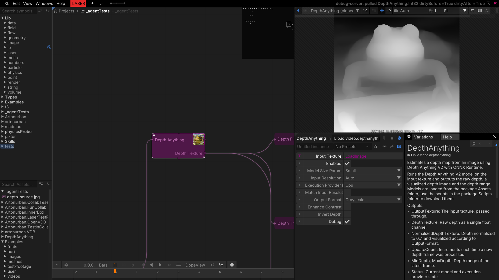
*The depth map on the frog example image, with provider and format settings.*

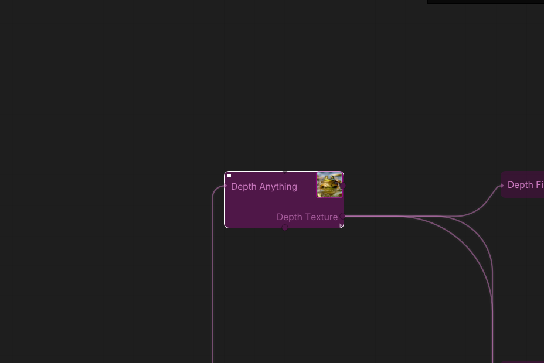
*`LoadImage` → `DepthAnything` → the three post-processing operators.*

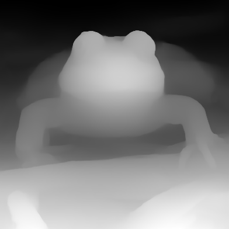
*The normalized depth of the frog image (small fp16 model, CPU).*

## DepthFilter

Edge-aware bilateral smoothing of a depth map. `SigmaSpace` sets the spatial radius, `SigmaColor` how
strongly depth differences are preserved; the filter averages neighbors only when their depth is
close, so silhouettes stay crisp while sensor noise and stepped bands disappear. It is the usual
cleanup before thresholding or normal generation.

- `DepthTexture` is the raw or normalized depth to filter.
- `SigmaSpace` is the spatial kernel radius in pixels.
- `SigmaColor` is the depth tolerance; larger values smooth across larger depth jumps.
- `Enabled` bypasses the filter.

**Output:** `FilteredDepth` (float depth).

*Note:* the raw float depth is displayed in the red channel — a red image is the depth, not an error.

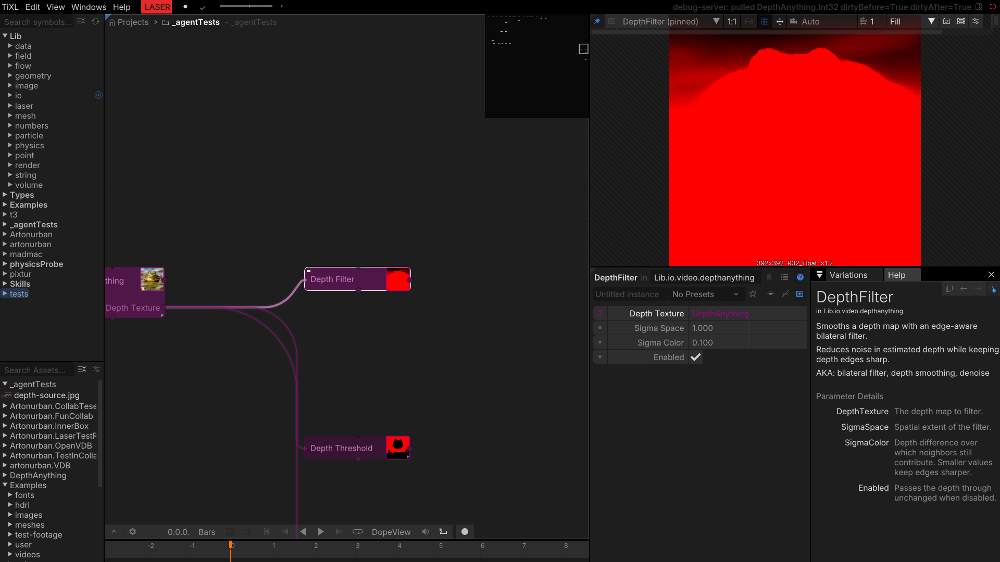
*Bilateral parameters next to the filtered output.*

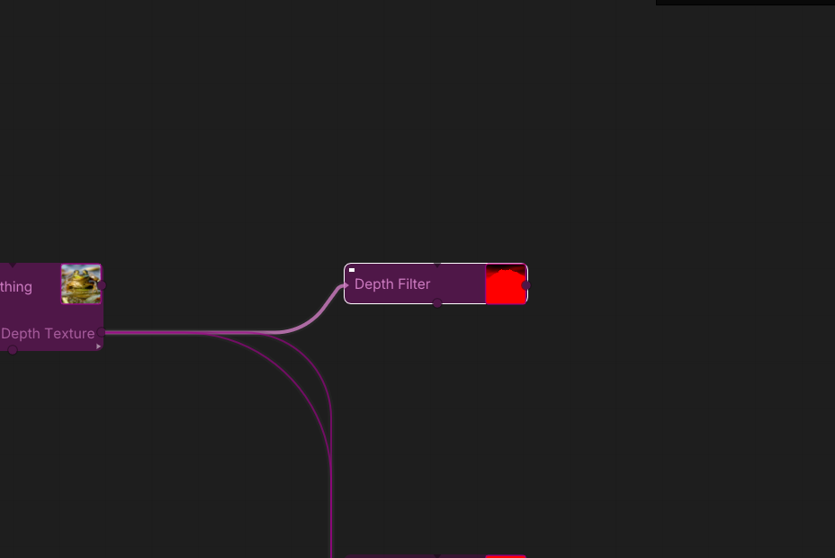
*The raw depth fed through the filter.*

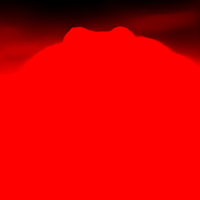
*The filtered float depth (shown in the red channel, as float textures are).*

## DepthToPosition

Unprojects a depth map into camera-space positions on the GPU: red, green and blue hold x, y and
the distance in front of the camera, alpha marks usable pixels. `FieldOfView` is the vertical angle
(`DepthAnything.VerticalFov` provides the model's estimate), `DepthScale` sets the size of the
reconstruction and `DepthIsDisparity` handles V2 output.

**Output:** `PositionTexture` (RGBA32F).

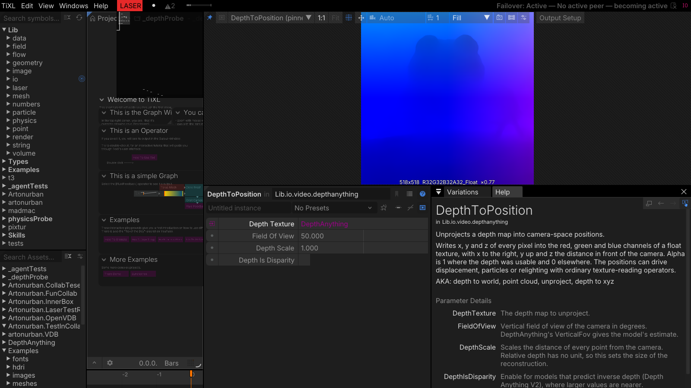
*The unprojection parameters next to the position texture.*

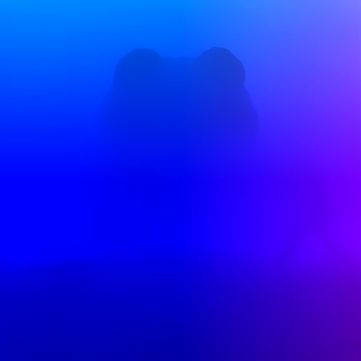
*Camera-space positions; the blue channel grows with distance.*

## DepthParallax

Shifts an image by its depth as if the camera moved sideways, for 2.5D camera moves on stills or live
video. `Offset` is the move, `FocalPlane` the depth that stays put, `MinDepth` and `MaxDepth` the depth
range (wire them from `DepthAnything`) and `Steps` the search quality at depth edges.

**Output:** `ResultTexture` (RGBA16F).

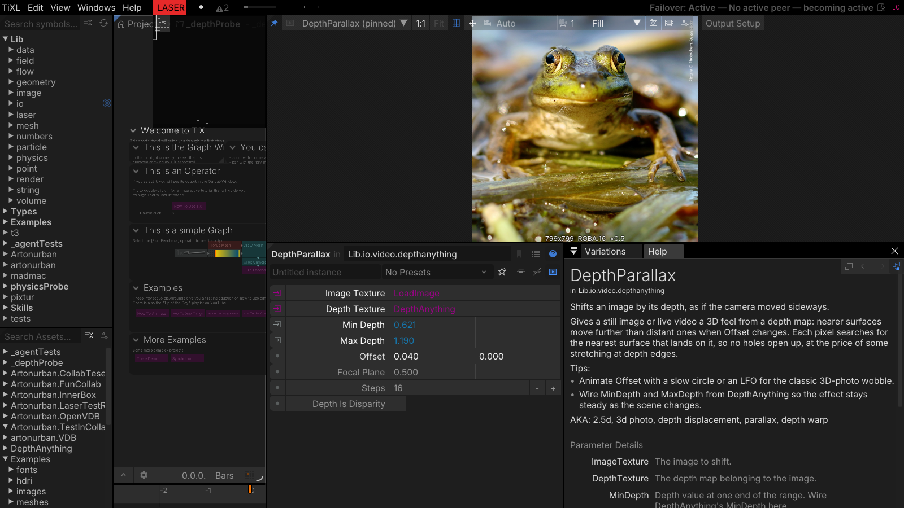
*The parallax inputs wired from DepthAnything, with a small horizontal offset.*

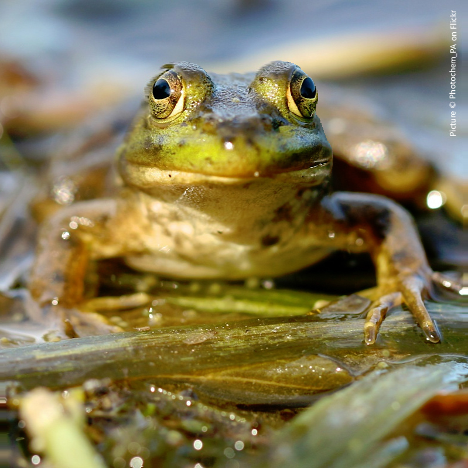
*The frog shifted against its background; the gather keeps depth edges from opening holes.*

## DepthThreshold

Turns a depth range into a binary mask. With `UseNormalized` on, the thresholds refer to the frame's
depth range (0 = nearest, 1 = farthest), so the same values keep working as the scene changes. The
mask is the standard way to separate a foreground subject from the background.

- `DepthTexture` is the depth map (raw or filtered).
- `MinThreshold` / `MaxThreshold` select the kept depth band.
- `Invert` flips the mask (keep the background instead).
- `UseNormalized` interprets the thresholds relative to the frame's depth range instead of absolute
  depth values.

**Outputs:** `MaskTexture` (binary mask) and `PixelRatio` (the fraction of the image that is masked).

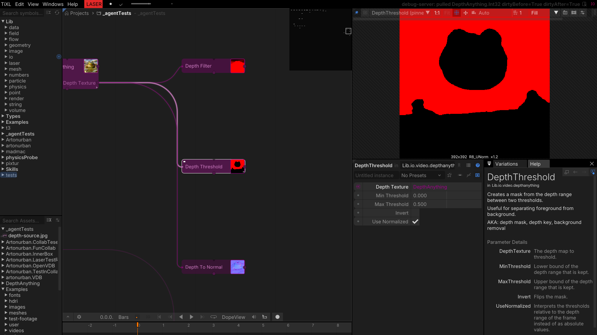
*The mask range and the resulting silhouette.*

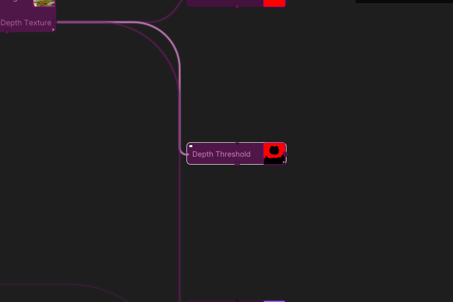
*The threshold branch of the chain.*

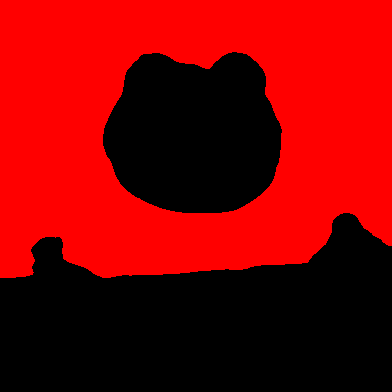
*The frog separated from the background.*

## DepthToNormal

Reconstructs a normal map from a depth map with Sobel edge detection. `Strength` scales the surface
slope and `Invert` flips the handedness, so the result can feed lighting, relighting or shading
setups that expect world- or view-space normals.

- `DepthTexture` is the depth map.
- `Strength` scales the normal slope.
- `Invert` flips the normal direction/convention.

**Output:** `NormalTexture`.

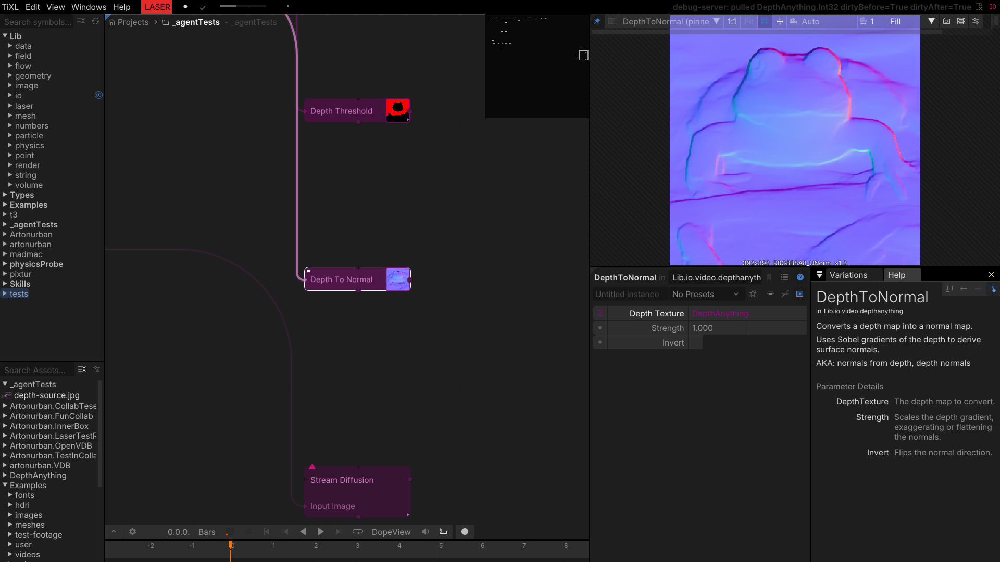
*Normal reconstruction parameters.*

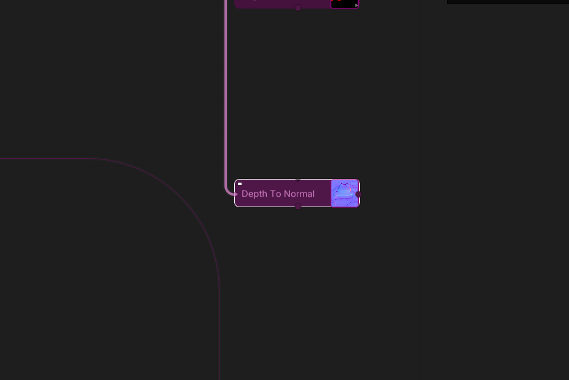
*The last branch of the depth chain.*

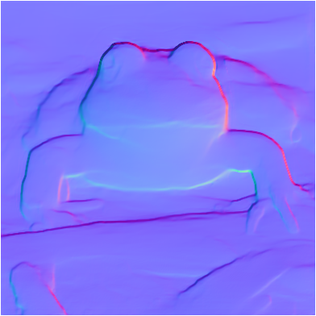
*Normals reconstructed from the depth map.*

## DepthScanBuffer

A LiDAR-style scan buffer for depth: while `Capture` is on, every incoming depth frame is
merged into one persistent map that is held on the outputs until `Reset` - the held scan
survives a disconnected input, which is what makes "scan, then keep working with it"
possible. `Mode` picks the merge: `Latest` freezes the most recent frame, `Average`
averages all captures (per-pixel sample counts, so it is a true multi-frame average -
the LiDAR-style denoiser for a still camera), `Min` keeps the nearest surface and `Max`
the farthest. Merging runs on the CPU from a single in-flight readback, the same
back-pressured pattern the other depth readers use.

- `DepthMap` is the raw depth to scan (`DepthAnything.DepthTexture`, R32_Float).
- `Confidence` (optional) gates samples below `ConfidenceThreshold` out of the merge.
- `ColorMap` (optional) is held alongside the scan; it colors `PointCloud` and fills `HeldColor`.
- `Capture` merges every new frame while on; `CaptureOnce` merges exactly one; `Reset` clears.
- `Mode` picks Latest / Average / Min / Max; `MaxCaptures` stops merging after N frames (0 = keep going).
- `Save` + `SaveFolder`/`SaveFileName`/`SaveFormat` write the scan: 16-bit PNG (`depth x SaveScale`, 1000 = millimeters) or exact raw float32 with a small `T3DS` header.
- `FieldOfView`, `PointScale`, `PixelStride`, `MaxPoints` shape the `PointCloud` unprojection.
- `CameraReference` (wire `DepthAnything.CamReference`) unprojects the cloud into the camera's world space (pose + frustum from `ICamera`); without it the cloud stays in DA3-style camera space (+Z forward, like `DepthToPoints`).

**Output:** `HeldDepth` (R32_Float), `HeldColor` (RGBA8), `MaskTexture` (R8),
`PointCloud` + `PointCount` (CPU-built point buffer - draws on D3D11 and Vulkan, unlike
the compute-written buffer of `DepthToPoints` which needs Vulkan), `Coverage`, `Captures`,
`SavedPath`.

`StartRecord` / `StopRecord` latch a recording run (with a `Recording` output), so scanning
can be driven like a LiDAR session instead of holding a bool. `SampleLifetime` gives every
sample a lifetime in seconds: pixels not re-observed within that time are dropped, so the
scan fades like a decaying sweep and `Coverage` / masks / point cloud follow. For stable
points on a live scan, `PointGrid` picks Square or Hexagonal sampling (hex = offset rows at
sqrt(3)/2 spacing, even neighbor distances) and `PointStability` blends rebuilt point
positions toward their previous spots to minimize jitter.

*Note:* the held outputs keep publishing the last scan even when the input stops; a size
change of the incoming depth resets the buffer and starts a fresh scan.

## DepthScan3D

The 3D sibling of `DepthScanBuffer`: depth is unprojected into a persistent **world-space
point cloud** instead of a held 2D map. The camera pose comes from
`DepthAnything.CamReference` (DA3 estimates pose and vertical FOV per frame); without it,
points stay in DA3 camera space like `DepthToPoints`.

- Every valid pixel is unprojected and inserted into a voxel grid of `VoxelSize` (the min-distance knob: points never sit closer than that).
- Overlapping observations merge: `Mode: Average` keeps a weighted running mean per voxel (true multi-frame denoising), `Mode: Replace` lets the latest observation win.
- `Confidence` gating, `ColorMap` coloring and `SampleLifetime` aging work like in `DepthScanBuffer` - the cloud follows what the camera keeps seeing.
- `StartRecord`/`StopRecord` latch a hands-free recording run; `MaxPoints` caps the cloud.

**Output:** `Points` + `PointCount` (CPU-built Point buffer - draws on D3D11 and
Vulkan), `Captures`, `PointsAdded`, `SavedPath`, `Recording`. Save writes a **PLY**
(binary or ASCII) that opens in MeshLab, CloudCompare or Blender.

*Note:* pixel-wise fusion assumes the pose source is consistent; DA3's monocular pose
drifts over long hand scans, so slow scans or a turntable give the cleanest clouds.

## StreamDiffusion

Image generation with **Stable Diffusion 1.x / SD-Turbo** through ONNX Runtime, in text-to-image and
image-to-image modes. The operator runs a streamed pipeline: the UNet, VAE and text encoder are
separate ONNX files in `EnginePath`, the tokenizer files sit next to them, and `vae_encoder.onnx` is
needed for image-to-image. `TriggerGenerate` renders one frame; `AutoGenerate` keeps generating for a
live output.

- `EnginePath` points at a folder containing `unet.onnx`, `vae_decoder.onnx`, `text_encoder.onnx`,
  the tokenizer files, and `vae_encoder.onnx` for img2img.
- `Mode` selects text-to-image or image-to-image.
- `Prompt` / `NegativePrompt` drive the generation; `Seed` makes it repeatable (-1 = random).
- `Width` / `Height` are the generation size; `MatchInputSize` follows the input image instead.
- `Guidance` is the classifier-free guidance scale; `Strength` how much an img2img pass changes the
  input; `Steps` the number of denoising steps (1 is the SD-Turbo default).
- `InputImage` is required for img2img mode.
- `ModelType` selects SD 1.x or SD-Turbo; `CudaDevice` and `ExecutionProviderParam` choose the GPU.
- `TriggerGenerate` renders one frame on a flank; `AutoGenerate` runs continuously.

**Outputs:** `Output` (the generated texture), `OutputSize`, `GenerationTime` (seconds for the last
frame).

> The ONNX engine files are not installed on this machine, so the screenshots document the operator
> and its inputs rather than a generated frame. Put the engine folder in place and point
> `EnginePath` at it to enable generation.

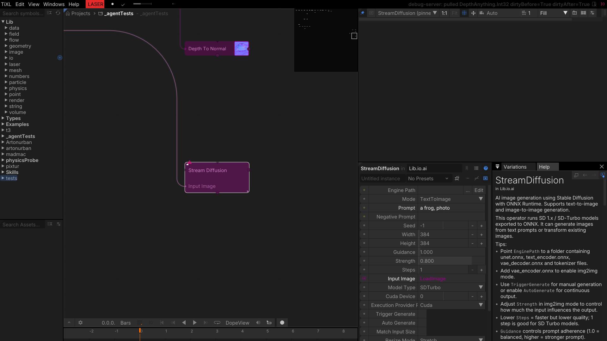
*Prompt, mode and sampling parameters with the operator help.*

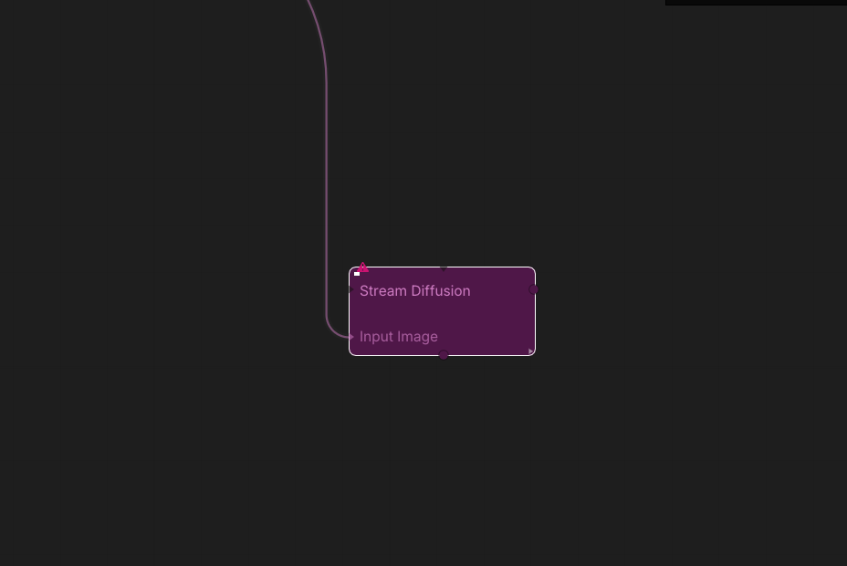
*The image input wired from the example image.*

## Examples

| Example | Shows |
| --- | --- |
| `DepthAnythingExample` | The op on a test image with its core inputs (model, resolution) at their defaults |
| `DepthAnythingExampleNormalSurface` | `DepthToNormal` over the depth result, lit as a surface |
| `DepthAnythingExampleParallaxMove` | `DepthParallax` driving a camera move from the depth layers |
| `DepthAnythingLiveExample` | The op on a live `VideoDeviceInput` feed instead of a file |
| `DepthAnythingSplatExample` | Depth-gated splat rendering over an RTSP stream |
| `StreamDiffusionExample` | Text-to-image streaming with the operator's pacing inputs |
| `StreamDiffusionExampleImg2ImgRestyle` | An input image restyled by a prompt; Strength rides the balance |
| `StreamDiffusionExampleV2Restyle` | The V2 pipeline restyling a live source |
| `PtzRoomScanExample` | `DepthScanBuffer` + `PtzScanPath` scanning a room with the PTZ rig |

> The StreamDiffusion and PtzRoomScan examples need model files from the local model store
> (`EnginePath` / `ModelPath`) — without them they show their graceful "waiting for model" state.
